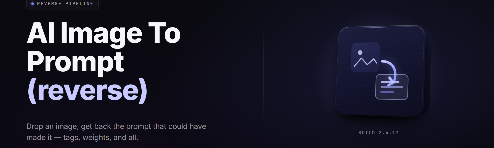

  
  
  

  

  
  

---

**Drop an image. Get the prompt that made it. Local inference, no cloud round-trip, no account.**

---

## 📋 Overview

| Category | Details |
|---|---|
| **Name** | image-to-prompt-reverse |
| **What it is** | Reverse prompt generator — reads any image, outputs the text prompt most likely to have produced it |
| **Runtime** | Native Windows `.exe`, no Python/Node required on the end-user machine |
| **Models** | Bundled CLIP-Interrogator, BLIP-2 captioner, WD14 tagger, custom SDXL-refiner head |
| **Outputs** | Plain prompt, JSON (tags + weights), Stable Diffusion / MidJourney / Flux formatted variants |
| **Inference** | 100% local. ONNX Runtime + DirectML. Nothing leaves your box. |
| **Formats** | PNG, JPG, WEBP, AVIF, TIFF, BMP, and folder-batch |
| **Version** | v2.4.1 (build 20260114) |

image-to-prompt-reverse is a desktop reverse-prompting tool for people who find an image they love and want to *rebuild* it — not just describe it. You feed it a file, it walks a multi-model ensemble, and it hands you back a prompt string tuned to the exact generator you're targeting. Whether you're reproducing a MidJourney render, seeding a Flux workflow, or reverse-engineering a LoRA's training aesthetic, the `.exe` handles the whole chain: image load → preprocess → tag → caption → weight → format.

  

---

## 🧩 All modules — live status

| Module | Status | Description |
|---|---|---|
| `ingest.core` | ✅ Working | Decoder pipeline for PNG/JPG/WEBP/AVIF/TIFF/BMP, EXIF strip, ICC normalize |
| `ingest.batch` | ✅ Working | Directory walker with glob filters, incremental queue, resume-on-crash |
| `preprocess.resize` | ✅ Working | Lanczos downscale, aspect-preserving pad, tiling for >4K sources |
| `preprocess.alpha` | ✅ Working | Alpha-channel flattening against chosen backdrop before tagging |
| `clip.interrogate` | ✅ Working | CLIP-Interrogator v2, artist/style/flavor modifiers |
| `blip2.caption` | ✅ Working | BLIP-2 OPT-2.7B captioner for natural-language base strings |
| `wd14.tagger` | ✅ Working | WD14 SwinV2 tagger, 10k-tag vocabulary, threshold sweep UI |
| `sdxl.refine` | ✅ Working | SDXL-refiner head reweights tags against target-checkpoint bias |
| `weight.scorer` | ✅ Working | Per-tag confidence scoring, min/max clip, top-K selection |
| `format.sd` | ✅ Working | Stable Diffusion A1111/ComfyUI prompt emitter with `(token:1.23)` weights |
| `format.mj` | ✅ Working | MidJourney emitter with `--ar --style --stylize` param block |
| `format.flux` | ✅ Working | Flux.1 natural-language emitter, comma-free clause ordering |
| `format.json` | ✅ Working | Structured JSON export: tags[], weights{}, model_hint, seed_guess |
| `negative.gen` | ✅ Working | Auto-negatives from low-confidence tag residue |
| `seed.guess` | ✅ Working | Heuristic seed/aesthetic fingerprint guess (best-effort, non-authoritative) |
| `lora.matcher` | ✅ Working | Cosine-similarity match against bundled LoRA aesthetic fingerprints |
| `ui.canvas` | ✅ Working | Drag-drop canvas, side-by-side source/preview, live prompt panes |
| `ui.history` | ✅ Working | Session history, diff view, pin/reject tagging for fine-tune feedback |
| `export.clip` | ✅ Working | One-click copy to clipboard in any target format |

---

## 🖥️ Compatibility / platform support

| Platform | Minimum | Recommended | Notes |
|---|---|---|---|
| Windows 10 | 21H2, 8 GB RAM | — | CPU-only fallback, ~40s per 1MP image |
| Windows 11 | 22H2, 16 GB RAM | 23H2, 32 GB RAM | Full DirectML GPU path |
| GPU — NVIDIA | GTX 1660 6 GB | RTX 3070 8 GB+ | CUDA 12 via DirectML bridge |
| GPU — AMD | RX 6600 8 GB | RX 7800 XT 16 GB | Native DirectML, no ROCm |
| GPU — Intel | Arc A750 8 GB | Arc B580 12 GB | Xe-HPG supported |
| Apple Silicon | — | — | Not supported (Windows-native release) |
| Linux / Wine | Best-effort | — | Not an official target |

---

## 🧪 Installation

1) **Visit the project page.** Open the repository's landing page in your browser — that's where the current release lives, alongside the changelog and any hotfix notes.

2) **Download the archive.** Grab the latest Windows archive from the landing page. It ships as a single self-contained folder — no installer wizard, no silent background services, nothing that writes to your registry.

3) **Extract anywhere.** Right-click the archive → *Extract All*. Any writable folder works: `Desktop`, `D:\tools\`, a USB stick. Avoid `C:\Program Files\` if you don't want to run as admin.

4) **Run the `.exe`.** Double-click the executable inside the extracted folder. First launch unpacks the bundled model weights to a local `models\` subfolder (~2.1 GB) — this takes about 60 seconds on an NVMe drive and happens exactly once.

5) **Drop an image.** Drag any PNG/JPG/WEBP onto the canvas. The ensemble runs, and the prompt panes fill in within a few seconds on a supported GPU.

---

## 🎨 Tagging & interrogation modules

The interrogation layer is the heart of the tool. Four independent models each see the image slightly differently — CLIP reads aesthetic and style, BLIP-2 writes a human-sounding sentence, WD14 produces dense danbooru-style tags, and the SDXL-refiner head reweights everything against whatever base checkpoint you tell it you're targeting.

- **CLIP-Interrogator v2** — the classic artist/style/flavor triple with per-mode modifiers. Fast, reliable, slightly generic on photoreal sources.
- **BLIP-2 captioner** — turns the image into a clean natural-language sentence, ideal as a base string for Flux and DALL·E-style emitters.
- **WD14 SwinV2 tagger** — 10,000-tag vocabulary, adjustable threshold slider, character/copyright/general category split.
- **SDXL-refiner head** — takes the raw tag soup and reweights it against the statistical bias of a chosen checkpoint, so the prompt actually lands on-target.
- **Confidence scorer** — every tag carries a 0.00–1.00 score; you set the floor, the ceiling, and the top-K cutoff.
- **Negative generator** — pulls the low-confidence residue into a ready-made negative prompt instead of throwing it away.

---

## 🧮 Weighting, seeds & LoRA matching

Once the tags exist, the weighting engine turns them into a *prompt* rather than a *list*. This is where most reverse tools stop short — they hand you comma-separated words and call it done. The engine here keeps per-tag confidence, applies your chosen weighting scheme, and emits the syntax that your target generator actually parses.

- **Weight schemes** — linear, exponential, and "A1111-native" `(token:weight)` output, switchable per export.
- **Seed guesser** — a heuristic fingerprint that suggests plausible seed ranges for the aesthetic you're seeing. Best-effort, never authoritative, clearly labelled as a guess.
- **LoRA matcher** — cosine-matches the prompt vector against a bundled set of LoRA aesthetic fingerprints and suggests the closest match by name.
- **Model hint** — a single field at the top of the JSON export suggesting which base checkpoint family the image most resembles.
- **Weight sweep preview** — see how the prompt string changes as you drag the global weight multiplier, before you commit.

---

## 📤 Export formats

Different generators want different strings. You get four emitters, all one-click, all clipboard-ready.

- **Stable Diffusion (A1111 / ComfyUI)** — comma-separated tags with `(token:1.23)` weight syntax, matching negative prompt, ready to paste.
- **MidJourney** — comma-separated descriptors followed by a `--ar --style --stylize --v` parameter block, kept within MJ's prompt-length habits.
- **Flux.1** — natural-language clause ordering, comma-free, tuned to Flux's tokenizer preferences.
- **Structured JSON** — `{ "tags": [...], "weights": {...}, "model_hint": "...", "seed_guess": "..." }` for people wiring this into their own pipeline.

---

## ⚙️ Interface & workflow

- **Drag-drop canvas** — drop an image, see it beside the live prompt pane, toggle between raw and refined views.
- **Side-by-side preview** — the source image on the left, a re-render preview slot on the right if you've wired up an optional generator.
- **History & diff** — every interrogation is stored in-session; diff two results to see exactly which tags changed.
- **Pin / reject feedback** — pin good tags, reject bad ones; the local feedback log is used to bias future runs on similar images.
- **Batch queue** — point it at a folder, walk away, come back to a CSV of prompts. Resumes on crash.
- **Keyboard-first** — `Ctrl+V` pastes an image from clipboard, `Ctrl+C` copies the current prompt, `Ctrl+E` cycles export format.

---

## ⚖️ Comparison

| Aspect | Cloud reverse-prompt services | Generic CLIP scripts | This Tool |
|---|---|---|---|
| Privacy | Image uploaded to a server | Local, but no UI | Local, no upload |
| Setup | Browser + account | Python env + deps | Extract `.exe`, run |
| Model ensemble | Usually one model | One or two | Four-model ensemble |
| Target-format output | Plain text only | Raw tags | SD / MJ / Flux / JSON |
| Weighting syntax | Rarely | Manual | Automatic per target |
| LoRA matching | Absent | Absent | Bundled fingerprint set |
| Batch mode | Paywalled | Script-y | Built-in queue + CSV |
| Cost | Subscription or credits | Free, dev tax | Free, one download |

---

## 📖 What is reverse prompting?

| Term | Explanation |
|---|---|
| **Reverse prompting** | The act of reading an image and reconstructing the text prompt most likely to have produced it |
| **Interrogation** | Running a captioning/tagging model over an image to extract descriptive tokens |
| **Tag** | A single descriptive token — `"cinematic lighting"`, `"1girl"`, `"oil painting"` — pulled from a model's vocabulary |
| **Weight** | A numeric multiplier attached to a tag that tells the target generator how strongly to emphasize it |
| **Negative prompt** | Tokens the generator should *avoid* — usually derived from low-confidence tag residue |
| **Ensemble** | Running multiple models over the same image and merging their outputs |
| **LoRA fingerprint** | A vector signature of an aesthetic that can be matched against a prompt for style suggestion |

Reverse prompting isn't magic, and the tool is honest about that. It's an *aesthetic approximation* — it gives you a prompt that a generator would plausibly accept as a description of what's in front of it. In practice that's exactly what most users want: a starting point that's 80% of the way there, which they then refine by hand.

---

## 🐛 Known issues

| Issue | Solution |
|---|---|
| First launch takes long while models unpack | Expected — one-time ~2.1 GB extraction to `models\`. Subsequent launches are instant. |
| DirectML GPU path falls back to CPU on some Intel iGPUs | Force GPU in settings → *Acceleration* → *DirectML*, and update to the latest Intel graphics driver (32.0.101.xxxx or newer). |
| AVIF decode fails on very old Windows 10 builds | Pre-convert to PNG, or update to 21H2+. The bundled AVIF decoder needs a modern Media Foundation stack. |
| Very large images (>8K) can OOM on 8 GB GPUs | Use *Preprocess → Tiled* mode; it splits the image into overlapping tiles before tagging. |
| WD14 tagger produces character tags for photoreal images | Lower the WD14 threshold in settings, or disable the *character* category in the tagger config. |
| Batch queue stalls on a corrupt file | The queue logs the failing path to `logs\batch_errors.txt` and continues with the next file. Fix or remove the file, re-run. |

---

## 😖 The Problem

- **You find an image you want to rebuild — and you have no prompt.** Staring at a render you love with zero idea what words would summon it is the single most common frustration in the AI-art community.
- **Cloud reverse tools want your image.** Every popular web-based interrogator uploads your file to a server. For personal artwork, unreleased renders, or client work, that's a hard no.
- **Generic CLIP scripts spit out raw tag soup.** Comma-separated garbage with no weighting, no negative prompt, no target-format awareness. You still have to do all the work.
- **Every generator wants a different prompt shape.** A1111 tags aren't MidJourney's shape, and MidJourney's shape isn't Flux's. Converting between them by hand is tedious and error-prone.
- **You can't tell where the model got it right.** Most tools give you a flat list with no confidence info, so you can't tell which tags are load-bearing and which are noise.
- **Batch work is paywalled or script-y.** If you have 200 reference images, you either pay a subscription or write your own pipeline.

---

## 🛠️ The Solution

| Problem | Solution |
|---|---|
| No prompt to rebuild an image | Four-model ensemble interrogates the image and emits a prompt string |
| Cloud tools upload your files | 100% local inference — ONNX Runtime + DirectML, no network calls |
| Raw tag soup with no structure | Weighting engine applies per-tag confidence and emits target-native syntax |
| Per-generator prompt shapes | Four dedicated emitters: SD, MidJourney, Flux, JSON |
| No confidence info | Every tag carries a 0.00–1.00 score, with adjustable floor/ceiling |
| Paywalled batch mode | Built-in batch queue with CSV export, no limits, no account |

---

## 🚀 Quick Start

1. 🖼️ **Get the tool.** Visit the project page, download the archive, extract, run the `.exe`.
2. 📂 **Drop an image.** Drag a PNG, JPG, or WEBP onto the canvas — or hit `Ctrl+V` to paste from clipboard.
3. 🎛️ **Pick a target format.** Choose Stable Diffusion, MidJourney, Flux, or JSON from the export dropdown.
4. ⚙️ **Tune the weights.** Drag the global weight multiplier and threshold sliders until the prompt string looks right.
5. 📋 **Copy and use.** Hit `Ctrl+C` or click *Copy* — the prompt is on your clipboard in the syntax your generator expects.

---

## 🧭 Table of Contents

- [Overview](#-overview)
- [All modules — live status](#-all-modules--live-status)
- [Compatibility / platform support](#️-compatibility--platform-support)
- [Installation](#-installation)
- [Tagging & interrogation modules](#-tagging--interrogation-modules)
- [Weighting, seeds & LoRA matching](#-weighting-seeds--lora-matching)
- [Export formats](#-export-formats)
- [Interface & workflow](#️-interface--workflow)
- [Comparison](#️-comparison)
- [What is reverse prompting?](#-what-is-reverse-prompting)
- [Known Issues](#-known-issues)
- [The Problem](#-the-problem)
- [The Solution](#️-the-solution)
- [Quick Start](#-quick-start)
- [System Requirements](#-system-requirements)
- [FAQ](#-faq)
- [Changelog](#-changelog)

---

## 📐 System Requirements

| Component | Minimum | Recommended |
|---|---|---|
| OS | Windows 10 21H2 | Windows 11 23H2 |
| CPU | 4 cores, AVX2 | 8 cores, AVX-512 |
| RAM | 8 GB | 16–32 GB |
| GPU | Not required (CPU fallback) | NVIDIA RTX 3060+ / AMD RX 6700+ / Intel Arc A750+ |
| VRAM | — | 8 GB+ |
| Disk | 4 GB free (extracted + models) | 6 GB free on NVMe |
| Display | 1280×720 | 1920×1080 or higher |

---

## ❓ FAQ

1. **Does this tool upload my images anywhere?**
   No. All inference is local — the models are bundled, and the process makes no outbound network calls during interrogation. You can run it with the network cable unplugged.

2. **Is the reverse prompt "the original prompt"?**
   No, and any tool that claims otherwise is lying. Reverse prompting is approximation. This tool gives you a prompt that a generator would plausibly accept as a description of the image — a strong starting point, not a recovery of lost data.

3. **Which model should I pick for which image?**
   CLIP is best for aesthetic and style. BLIP-2 is best for photographic images and natural-language targets. WD14 is best for anime/illustration and dense tag extraction. The SDXL-refiner is best when you know your target checkpoint. Run all four and merge in the ensemble view.

4. **Do I need Python or Node installed?**
   No. The `.exe` bundles everything. Extract and run.

5. **Why is the first launch slow?**
   The bundled model weights unpack to a local `models\` folder on first run — about 2.1 GB, once. After that, launches are instant.

6. **Can I run this on a laptop with no dedicated GPU?**
   Yes. CPU mode works and produces identical output, just slower — roughly 40 seconds per megapixel on a modern laptop CPU.

7. **Does the batch queue overwrite my existing results?**
   No. Each batch run writes to a new timestamped CSV in `output\`. Nothing is overwritten without a prompt.

8. **Can I wire this into ComfyUI or A1111?**
   Yes. The JSON export is designed for pipeline integration — it contains tags, weights, model hint, and seed guess in a stable schema.

9. **What if I disagree with the tags?**
   Pin or reject them. The feedback log biases future runs on similar images, and it's stored locally — nothing is sent anywhere.

10. **Are there any hidden telemetry calls?**
   None. The `.exe` contains no analytics, no crash reporter with a remote endpoint, and no update pings. What you extract is what runs.

---

## 📝 Changelog

**v2.4.1 (2026-01-14)** — Fixed tiling OOM on 8K+ images with 8 GB GPUs; improved AVIF decoder stability on 21H2.

**v2.4.0 (2025-12-20)** — Added Flux.1 emitter, LoRA matcher, batch CSV export, history diff view.

**v2.3.4 (2025-11-30)** — WD14 tagger vocabulary expanded to 10k tags; threshold sweep UI added.

---

The tool exists because reverse prompting should be a *local, honest, target-aware* process — not a cloud service that uploads your files and hands back a comma-separated list. Everything in the archive works offline, the ensemble is transparent about its confidence, and the output is shaped for the generator you're actually using. Download it, extract it, run it, and see what the image in front of you was trying to say.

  

